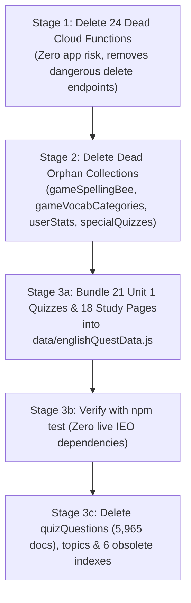

# G60 Report: Old Content & Cloud Functions Inventory (Read-Only)

**Task:** ⭐ Old content + cloud functions: inventory first (read-only), then cleanup after owner OK  
**Owner Decision (2026-11-07):** *"Get rid of older content and cloud functions; they waste space and might cost money or cause bugs. Pratha is comfortable with the new stuff."*  
**Author:** Gemini  
**Date:** 2026-11-07  
**Branch:** `gemini/g60-old-content-inventory`  
**Execution Mode:** **READ-ONLY.** No documents, functions, storage buckets, or indexes have been deleted.

---

## 1. Executive Summary

Over the past year, Apprec8 evolved through three content architectures:
1. **Architecture V1 (Early 2025):** Dynamic Firestore-first content. External Python/Node scripts called unauthenticated HTTP endpoints (`functions/api/*.js`) to populate `categories`, `topics`, `quizQuestions` (5,965 docs), `studyContent` (232 docs), `gameVocabCategories`, and `gameSpellingBee`.
2. **Architecture V1.5 (Mid 2025):** Space Science Olympiad (`quest_nodes`, 49 docs) with hardcoded seeding via `SeedQuestNodesButton.js`.
3. **Architecture V2 (Current - Late 2025):** Bundled tile quests (`data/englishQuestData.js`, `scienceQuestData.js`, `wordPowerQuestData.js`, `wordBankQuestData.js`) stored in git and seeded to `quests/{questId}/nodes` + `questions` in V2 format via admin seed buttons.

### Key Inventory Findings
- **Firestore Collections:** 30 top-level collections found. **10 collections (over 10,000 documents) are completely legacy** and can be deleted once English Quest Unit 1 dependencies are bundled.
- **English Quest Unit 1 Dependency (Blocker for `quizQuestions`):** English Quest Unit 1 still dynamically queries Firestore for **21 legacy quizzes** in `quizQuestions` and **18 study pages** in `studyContent`. These must be bundled into `data/englishQuestData.js` before `quizQuestions` is deleted.
- **Cloud Functions:** **57 functions deployed**. Exactly **24 are obsolete HTTP endpoints** in `functions/api/`, including high-risk administrative wipe endpoints (`deleteAllDocuments`, `bulkDeleteGameDocs`). None of these 24 are called by the mobile client app.
- **Storage Buckets:** 6 Google Cloud Storage buckets found. 2 buckets (`apprec8-ca229-firestore-backup-2025apr22` and `may-8-2025`) are stale one-off backup exports from Spring 2025.
- **Firestore Indexes:** 11 composite indexes deployed. **6 composite indexes** belong exclusively to the legacy `topics` and `quizQuestions` collections and will become redundant once those collections are deleted.

---

## 2. Firestore Collections Inventory

Exact live document counts retrieved via Firestore aggregation queries (`.count().get()`):

| Collection Name | Doc Count | Approx. Size | App Usage / Who Reads It | Recommendation | Rationale |
|---|---|---|---|---|---|
| `quizQuestions` | **5,965** | ~3.0 MB | English Quest Unit 1 (21 quizzes); legacy IEO/NSO/IMO quizzes | **MIGRATE → DELETE** | 5,944 docs are dead legacy. 21 quizzes are reused by Unit 1; once copied to `data/englishQuestData.js`, all 5,965 docs can be deleted. |
| `questions` | **3,393** | ~2.0 MB | Active tile quests (`eq` 1787, `sq` 615, `wb` 369, `wp` 339, `space` 265) | **KEEP** | Modern V2 question store for all tile quests. |
| `topics` | **511** | ~150 KB | LinksScreen (legacy explorer); legacy category navigation | **DELETE (Stage 2)** | Unused by modern tile quests; only used by old category browsers. |
| `studyContent` | **232** | ~460 KB | Active quests (`eq` 59, `sq` 18, `wb` 34, `wp` 8); Space bio/study (24); legacy (89) | **KEEP ACTIVE / PRUNE LEGACY** | Keep active quest and space study pages. Delete 89 orphan legacy study pages. |
| `questAttempts` | **1,091** | ~440 KB | `services/englishQuestApi.js`, `services/adminApi.js` | **KEEP** | Active child gameplay and quiz attempt history. |
| `users` | **144** | ~140 KB | Active user accounts (children, parents, teachers, testers) | **KEEP** | Core user identity and profiles. |
| `specialQuizzes` | **105** | ~10 KB | None (0 references in client code) | **DELETE (Stage 2)** | Obsolete feature flags for old special quizzes (`4ieo11-animals`, etc.). |
| `quest_nodes` | **49** | ~40 KB | Space Olympiad legacy map (`listenToQuestNodes`) | **KEEP (or MIGRATE)** | Keeps the Space quest map alive until Space is converted to a tile quest. |
| `userFeedback` | **39** | ~40 KB | `services/reportApi.js`, Me tab feedback FAB | **KEEP** | Active user issue reports and feedback pipeline (G66). |
| `categories` | **27** | ~30 KB | `HomeScreen.js`, `SeedQuestNodesButton.js` | **PRUNE LEGACY (Stage 2)** | Keep 4 quest tiles (`english-quest`, `science-quest`, `word-power`, `word-bank`). Delete 23 old category tiles. |
| `gameSpellingBee` | **24** | ~12 KB | None (Spelling Bee was removed from map on 2026-10-28) | **DELETE (Stage 2)** | Dead game content. |
| `gameVocabCategories` | **21** | ~90 KB | None (old Word Inspector / Vocab game) | **DELETE (Stage 2)** | Dead game content; has 420 docs in `words` subcollections. |
| `tasks` | **18** | ~20 KB | `HomeScreen.js`, `MeScreen.js`, `Tasks.js` (Reminders feature) | **KEEP** | Active reminders/tasks feature for users. |
| `questionIssues` | **13** | ~15 KB | `services/adminApi.js`, `services/reportApi.js` | **KEEP** | Aggregated question error reports for admin review. |
| `userStats` | **12** | ~4 KB | None (0 references in client code) | **DELETE (Stage 2)** | Orphaned early prototype collection; active stats live in `users/{uid}/stats`. |
| `childLoginCodes` | **4** | ~2 KB | `functions/callable/familyActions.js` (Child login with 6-char code) | **KEEP** | Active child login code system. |
| `quests` | **4** | ~10 KB | `HomeScreen.js`, tile quest metadata (`english-quest`, `science-quest`, etc.) | **KEEP** | Root documents for tile quests. |
| `classes` | **3** | ~10 KB | School classes (`services/classesApi.js`, demo school) | **KEEP** | Core school pilot feature. |
| `consents` | **3** | ~3 KB | Parental consent records (`services/classesApi.js`) | **KEEP** | Child safety & Play compliance records. |
| `parentPins` | **3** | ~2 KB | `functions/callable/familyActions.js` (Parent 4-digit PIN hashes) | **KEEP** | Parental lock & screen pinning security. |
| `quizzes` | **3** | ~3 KB | `services/firestoreContentApi.js` | **DELETE (Stage 2)** | Legacy quiz metadata (modern quests use bundled quiz definitions). |
| `wordInspectorQuizzes` | **3** | ~3 KB | `WordInspectorScreen.js` | **DELETE (Stage 2)** | Legacy Word Inspector game. |
| `schools` | **2** | ~5 KB | `services/classesApi.js` (Demo School & Pratha's school) | **KEEP** | School pilot records. |
| `parentLinkCodes` | **2** | ~2 KB | `functions/callable/familyActions.js` (Adult account linking) | **KEEP** | Parent linking feature. |
| `demo` | **1** | ~5 KB | `utils/demoSchool.js` (Demo School state) | **KEEP** | Seema rehearsal & demo school state. |
| `classCodes` | **1** | ~1 KB | `services/classesApi.js` (Student class join codes) | **KEEP** | Active class join codes. |
| `invites` | **1** | ~1 KB | `functions/callable/schoolActions.js` (Teacher invite codes) | **KEEP** | Teacher onboarding feature. |
| `leaderboardCache` | **1** | ~5 KB | `functions/callable/userActions.js` (10-minute cache) | **KEEP** | Cost-guard cache for global/class leaderboards. |
| `ownerConfig` | **1** | ~2 KB | `services/decisionsApi.js` (Feature flags & remote controls) | **KEEP** | Owner dashboard config. |
| `ownerDecisions` | **29** | ~30 KB | `services/decisionsApi.js` (Logged product & architecture decisions) | **KEEP** | Decision tracking records. |

### 2.1 Subcollection & Collection Group Inventory
- `quests/{questId}/nodes`:
  - `quests/english-quest/nodes`: 267 docs (Active)
  - `quests/science-quest/nodes`: 85 docs (Active)
  - `quests/word-bank/nodes`: 36 docs (Active)
  - `quests/word-power/nodes`: 35 docs (Active, expands to 37 with Champion leaves)
- `gameVocabCategories/{id}/words`: 21 categories × 20 word docs each = **420 documents** (Dead legacy → Delete in Stage 2).
- `collectionGroup(questProgress)`: 66 active child progress docs under `users/{uid}/questProgress/{questId}` (Active).
- `collectionGroup(members)`: 44 student membership records under `classes/{classId}/members` (Active).
- `collectionGroup(requests)`: 0 docs (Active subcollection for teacher approvals).
- `collectionGroup(paperSessions)`: 0 docs (Active subcollection for practice papers).

---

## 3. Detailed Analysis of Legacy Content Categories

### 3.1 The 27 `categories` in Firestore
Of the 27 categories currently in Firestore, only **4** are active tile quests:

| CarouselGroup | Category ID | Title | Topics Count | Recommendation |
|---|---|---|---|---|
| `quest` | `english-quest` | English Quest | 0 | **KEEP** (Tile Quest) |
| `quest` | `science-quest` | Science Quest | 0 | **KEEP** (Tile Quest) |
| `quest` | `word-power` | Word Power | 0 | **KEEP** (Tile Quest) |
| `quest` | `word-bank` | Treasure Words | 0 | **KEEP** (Tile Quest) |
| `olympiad` | `ieo` | English (Old IEO) | 202 topics | **MIGRATE UNIT 1 → DELETE** |
| `olympiad` | `nso` | Science (Old NSO) | 115 topics | **DELETE (Stage 2)** (Replaced by Science Quest) |
| `olympiad` | `imo` | Mathematics (Old IMO) | 61 topics | **DELETE (Stage 2)** |
| `olympiad` | `space-science` | Space Science Olympiad | 20 topics | **KEEP** (Powers legacy Space quest) |
| `olympiad` | `iho` | Hindi | 0 topics | **DELETE (Stage 2)** |
| `popular_quiz` | `animal-kindom` | The Animal Kingdom | 15 topics | **DELETE (Stage 2)** (Will return as new quest) |
| `popular_quiz` | `dog-quiz-1` | Dogs | 1 topic | **DELETE (Stage 2)** (Will return as new quest) |
| `popular_quiz` | `mathsTables` | Multiplication Tables | 9 topics | **DELETE (Stage 2)** |
| `book_summary` | `akbb1` | Akbar Birbal | 0 topics | **DELETE (Stage 2)** |
| `book_summary` | `bgh1` | Gautam Buddha - The Enlightened | 0 topics | **DELETE (Stage 2)** |
| `book_summary` | `bookSumm1` | Book Summaries | 15 topics | **DELETE (Stage 2)** |
| `book_summary` | `pct1` | पंचतंत्र की कहानियाँ | 15 topics | **DELETE (Stage 2)** |
| `classroom` | `hindi-misc` | हिंदी | 2 topics | **DELETE (Stage 2)** |
| `classroom` | `psy` | Psychology | 24 topics | **DELETE (Stage 2)** |
| `classroom` | `rsn` | Reasoning | 20 topics | **DELETE (Stage 2)** |
| `classroom` | `social-4` | Social Studies | 7 topics | **DELETE (Stage 2)** |
| `story` | `guess-the-time` | Guess The Time | 0 topics | **DELETE (Stage 2)** |
| `story` | `minesweeper` | Minesweeper | 0 topics | **DELETE (Stage 2)** |
| `story` | `spell-bee` | Spell Bee | 0 topics | **DELETE (Stage 2)** |
| `story` | `sudoku` | Sudoku | 0 topics | **DELETE (Stage 2)** |
| `story` | `vocab-builder` | Vocabulary Builder | 0 topics | **DELETE (Stage 2)** |
| `popular_read` | `sysd` | System Design | 0 topics | **DELETE (Stage 2)** |
| `to-be-deleted` | `quiz-coll` | Fun Quizzes | 5 topics | **DELETE (Stage 2)** |

### 3.2 Old Chapter Names Preserved for Future Inspiration
*(Owner requested: "Keep a list of the old chapter names (owner liked them: fun for kids) in the report.")*

These names from the legacy Firestore database were fun, imaginative, and engaging:

#### Animal Kingdom Chapters
- *Amazing Amphibians: Double Lives!*
- *Purr-fect Cats*
- *Creepy Crawlies & Amazing Insects*
- *Dashing Dogs*
- *Feathered Friends & Flying Aces*
- *Farmyard Fun*
- *Jungle Giants & Wild Wonders*
- *Miniature Marvels & Mighty Minis*
- *Ocean Oddballs & Deep Sea Divers*
- *Reptiles Rock! Scaly Superstars*

#### Panchatantra Stories (`pct1`)
- *🐒 बंदर और मगरमच्छ 🐊 (The Monkey and the Crocodile)*
- *🎼 संगीत वाला गधा 🫏 (The Musical Donkey)*
- *🐵 मूर्ख बन्दर और लकड़ी का खूंटा 🪵 (The Foolish Monkey and the Wedge)*
- *🐘 हाथी और खरगोश 🐇 (The Elephant and the Hare)*
- *🦁 शेर और चतुर खरगोश 🐇 (The Lion and the Clever Rabbit)*
- *🐺 नीला सियार (The Blue Jackal)*
- *🪽 बगुला भगत और केकड़ा 🦀 (The Cunning Crane and the Crab)*
- *🐢 बातूनी कछुआ (The Talkative Tortoise)*
- *👳‍♀️ ब्राह्मण और नेवला 🫫 (The Brahmin and the Mongoose)*
- *🕊 एकता में बल 🕊 (Strength in Unity)*
- *👳🏼 मूर्ख ब्राह्मण का सपना 🛌🏼 (The Daydreaming Brahmin)*
- *शेर बनाने वाले चार मूर्ख (The Four Friends Who Revived a Lion)*

#### Classic Children's Books (`bookSumm1`)
- *✨ Alice's Adventures in Wonderland*
- *✨ The Jungle Book*
- *✨ The Secret Garden*
- *✨ Around the World in Eighty Days*
- *✨ Peter Pan*
- *✨ The Adventures of Pinocchio*
- *✨ Treasure Island*
- *✨ The Wind in the Willows*
- *✨ The Wonderful Wizard of Oz*
- *✨ Anne of Green Gables*
- *✨ The Adventures of Tom Sawyer*
- *✨ Heidi*
- *✨ Just So Stories*
- *✨ A Little Princess*

#### Science Chapters (`nso`)
- *Plants 🪴🌱🌿 🫧🍃*
- *Animals 🐿️🦄🐴*
- *Food & Digestion 🍍🍎🍓🍇*
- *Human Needs 🏗👷‍♂️👮‍♂️🩺🥼💉*
- *Matter & Materials 🧱🔐⛓🖇*
- *Force, Work & Energy 🏋💪✍🏻🚜👷*
- *Our Environment 🌤️˖°𓇼🌊⋆🐚*
- *Earth & Universe 🌎🌕☄️🪐🚀*

---

## 4. Cloud Functions Inventory

We compared the 57 deployed functions in `firebase functions:list` against function definitions in `functions/` and client code in `screens/`, `components/`, `services/`, and `utils/`:

### 4.1 Summary
- **Total Deployed:** 57 functions
- **Active Client Callables (In Use):** 27 functions
- **Active Background Triggers / Schedulers:** 4 functions
- **Admin / Demo Utilities:** 2 functions
- **Obsolete / Dead HTTP Endpoints:** **24 functions (Ready for deletion)**

### 4.2 Group A: Active Client Callables (27 Functions) — KEEP
These functions are actively invoked by the mobile client app via `httpsCallable`:
1. `recordQuizResult` (Records quiz results, awards stars, updates streaks)
2. `penalizeQuizLeave` (Applies penalty for abandoning an active quiz)
3. `getLeaderboard` (Fetches global leaderboard)
4. `getClassLeaderboard` (Fetches class leaderboard)
5. `getCurrentUserRank` (Calculates rank of user)
6. `clapForClassmate` (Awards encouragement claps to peers)
7. `classTeam` (Calculates class team progress score)
8. `approveMember` (Teacher approves a pending student)
9. `assignTeacher` (Admin assigns a teacher to a class)
10. `findUserByEmail` (Looks up existing accounts by email for invites)
11. `createTeacherInvite` (Generates invite code for teachers)
12. `redeemTeacherInvite` (Teacher redeems code to join school)
13. `decideTeacherRequest` (Admin accepts/rejects teacher join request)
14. `createChildProfile` (Parent adds a supervised child profile)
15. `deleteChildProfile` (Parent deletes a supervised child profile)
16. `switchToChild` (Parent switches active session to child)
17. `switchToParent` (Child session returns to parent with PIN)
18. `setParentPin` (Sets 4-digit security PIN for parent mode)
19. `newChildLoginCode` (Generates temporary 6-character child login code)
20. `redeemChildLoginCode` (Child enters code on phone to sign in)
21. `createParentLinkCode` (Child generates code to link existing parent)
22. `redeemParentLinkCode` (Parent inputs code to link child account)
23. `requestAccountDeletion` (DR-19 "Delete means delete" full user erase)
24. `savePushSettings` (Adult opts into weekly push summary)
25. `submitFeedback` (User submits issue report / feedback from FAB)
26. `seedDemoSchool` (Admin tool: populates Demo School data)
27. `shiftDemoSchool` (Admin tool: advances demo school calendar for testing)

### 4.3 Group B: Active Event Triggers & Schedulers (4 Functions) — KEEP
1. `initializeNewUser` (Auth trigger on `user.create` — creates initial user document)
2. `onQuestionReported` (Firestore trigger on `userFeedback` — creates `questionIssues` entry)
3. `weeklyParentPush` (Cloud Scheduler: runs Sundays 18:30 IST — sends parent summary notification)
4. `weeklyTeacherPush` (Cloud Scheduler: runs Mondays 07:30 IST — sends teacher weekly digest)

### 4.4 Group C: Obsolete HTTP Endpoints (24 Functions) — DELETE (Stage 1)
These are legacy REST endpoints deployed as `httpsTrigger` with `v1` runtime. None of them are called by the mobile client app:

| Function Name | Source File | Stated Purpose | Risk Level | Reason to Delete |
|---|---|---|---|---|
| `deleteAllDocuments` | `functions/api/bulkOperations.js` | Wipes entire collections over HTTP | **CRITICAL** | Massive security hazard; unneeded in production. |
| `bulkDeleteGameDocs` | `functions/api/gameManagement.js` | Deletes game docs over HTTP | **HIGH** | Dangerous HTTP endpoint for dead games. |
| `deleteQuiz` | `functions/api/crudOperations.js` | Deletes a quiz doc by ID | Medium | Dead REST API; app uses Firestore SDK. |
| `deleteQuestions` | `functions/api/crudOperations.js` | Deletes questions by quizId | Medium | Dead REST API. |
| `deleteVocabCategory` | `functions/api/gameManagement.js` | Deletes a vocab category | Low | Dead REST API for obsolete vocab game. |
| `bulkAddCategories` | `functions/api/bulkOperations.js` | Batch inserts categories | Low | Superseded by in-app seed scripts. |
| `bulkAddTopics` | `functions/api/bulkOperations.js` | Batch inserts topics | Low | Superseded by in-app seed scripts. |
| `bulkAddQuizQuestions` | `functions/api/bulkOperations.js` | Batch inserts quizQuestions | Low | Superseded by in-app seed scripts. |
| `bulkAddStudyContent` | `functions/api/bulkOperations.js` | Batch inserts studyContent | Low | Superseded by in-app seed scripts. |
| `bulkAddVocabCategories` | `functions/api/gameManagement.js` | Batch inserts vocab categories | Low | Dead game content. |
| `bulkAddWordsToCategory` | `functions/api/gameManagement.js` | Batch inserts vocab words | Low | Dead game content. |
| `bulkAddSpellingBeePuzzles` | `functions/api/gameManagement.js` | Batch inserts spelling puzzles | Low | Dead game content. |
| `bulkAddWordInspectorQuizzes` | `functions/api/wordInspectorBulkOperations.js` | Batch inserts Word Inspector | Low | Dead game content. |
| `bulkGetWordInspectorQuizzes` | `functions/api/wordInspectorBulkOperations.js` | Fetches Word Inspector quizzes | Low | Dead game content. |
| `getGameContent` | `functions/api/gameManagement.js` | Fetches game content over HTTP | Low | Dead game content. |
| `getDocumentsById` | `functions/api/utility.js` | Batch reads documents by ID | Low | Dead REST utility. |
| `addCategory` | `functions/api/crudOperations.js` | Inserts single category | Low | Dead REST CRUD. |
| `addTopic` | `functions/api/crudOperations.js` | Inserts single topic | Low | Dead REST CRUD. |
| `createQuiz` | `functions/api/crudOperations.js` | Inserts single quiz doc | Low | Dead REST CRUD. |
| `addQuizQuestion` | `functions/api/crudOperations.js` | Inserts single question | Low | Dead REST CRUD. |
| `addStudyContent` | `functions/api/crudOperations.js` | Inserts single study doc | Low | Dead REST CRUD. |
| `addQuestions` | `functions/api/crudOperations.js` | Inserts questions array | Low | Dead REST CRUD. |
| `updateTopic` | `functions/api/crudOperations.js` | Updates topic doc | Low | Dead REST CRUD. |
| `updateQuizDetails` | `functions/api/crudOperations.js` | Updates quiz details | Low | Dead REST CRUD. |
| `updateQuestions` | `functions/api/crudOperations.js` | Updates question array | Low | Dead REST CRUD. |
| `updateFirestoreDocuments` | `functions/api/bulkOperations.js` | Generic document updater | Medium | Unneeded legacy utility. |

---

## 5. Cloud Storage, Indexes & Infrastructure Costs

### 5.1 Cloud Storage Buckets
1. **`apprec8-ca229.firebasestorage.app` (Default App Bucket):**
   - Active folders: `avatars/`
   - Stale legacy folders: `category_images/`, `community-helpers/`, `games/`, `imo/`, `misc/`, `psychology-11/`, `reasoning/`. All images for active quests are now hosted on GitHub/jsdelivr CDN (`data/media_backup`).
2. **`apprec8-ca229-firestore-backup-2025apr22`:**
   - One-time Firestore export created on 2025-04-22. Can be retained as a cold deep-archive or deleted once owner confirms old backup is no longer needed.
3. **`may-8-2025`:**
   - One-time Firestore export created on 2025-05-08. Can be archived or deleted.
4. **`gcf-sources-*`, `gcf-v2-*`:**
   - Automatically managed by Cloud Functions for deployment artifacts.

### 5.2 Composite Firestore Indexes
Currently, **11 composite indexes** exist in Firestore.
- **5 Active Indexes (KEEP):**
  - `questAttempts`: `userId` ASC, `createdAt` DESC (User attempt history)
  - `tasks`: `userId` ASC, `createdAt` DESC (Active reminders)
  - `tasks`: `creatorUid` ASC, `createdAt` DESC (Team reminders)
  - `tasks`: `assignToTeamBoolean` ASC, `createdAt` DESC (Team filter)
  - `categories`: `carouselGroup` ASC, `order` ASC (Home carousel)
- **6 Obsolete Indexes (DELETE after content cleanup):**
  - `quizQuestions`: `topicId` ASC, `order` ASC
  - `quizQuestions`: `parentId` ASC, `order` ASC
  - `topics`: `categoryId` ASC, `order` ASC
  - `topics`: `parentTopicId` ASC, `order` ASC
  - `topics`: `categoryId` ASC, `parentTopicId` ASC, `order` ASC
  - `topics`: `parentTopicId` ASC, `order` DESC

### 5.3 Cost Analysis (Monthly Estimates)
- **Firestore Compute & Storage:**
  - Storage: ~6.5 MB total (Free tier includes 1 GB).
  - Reads/Writes: Almost entirely driven by active app sessions; legacy collections incur **0 read costs** unless queried.
- **Cloud Functions:**
  - 57 deployed functions: Free tier covers 2,000,000 invocations and 400,000 GB-seconds.
  - Idle functions incur no execution cost, but **container image layers stored in Artifact Registry** incur a modest monthly storage fee (~$0.10–$0.50/month).
  - Deleting the 24 dead functions speeds up deployment times from ~4 minutes to ~1.5 minutes and prevents Artifact Registry bloat.

---

## 6. Proposed Deletion Plan (in 3 Safe Stages)

### Stage 1: Delete 24 Dead Cloud Functions (Immediate & Zero Risk)
- **Action:** Remove `crudOperations.js`, `bulkOperations.js`, `gameManagement.js`, `wordInspectorBulkOperations.js`, and `utility.js` from `functions/index.js` and delete the files.
- **Deploy:** `firebase deploy --only functions --project apprec8-ca229` (Cloud Functions will prune the 24 removed functions).
- **Impact on App:** **None.** 0 client files reference these endpoints. Eliminates `deleteAllDocuments` security vulnerability.

### Stage 2: Delete Completely Dead Collections & Categories
- **Action:**
  1. Delete `gameSpellingBee` (24 docs).
  2. Delete `gameVocabCategories` (21 docs + 420 words subcollection docs).
  3. Delete `wordInspectorQuizzes` (3 docs).
  4. Delete `specialQuizzes` (105 docs).
  5. Delete `userStats` (12 docs).
  6. Delete legacy `categories` (Akbar Birbal, Gautam Buddha, Psychology, System Design, etc.).
- **Impact on App:** **None.** None of these collections are accessed by active user flows.

### Stage 3: Migrate English Quest Unit 1 & Purge `quizQuestions`
- **Dependency:** English Quest Unit 1 reuses 21 quizzes from `quizQuestions` and 18 pages from `studyContent`.
- **Action:**
  1. Copy the 21 quizzes into `data/englishQuestData.js` in V2 format with `mistakeTag` and `subtopic`.
  2. Bundle the 18 study pages into `data/englishQuestData.js` (per G59 Learn cards plan).
  3. Run `npm test` to ensure 0 fallback reads to `quizQuestions` remain.
  4. Delete `quizQuestions` collection (5,965 docs) and legacy `topics` (511 docs).
  5. Delete the 6 obsolete Firestore composite indexes.

---

## 7. Safety & Backup Plan Before Any Deletion

Before a single document or function is removed:
1. **Local JSON Backup Outside Git:**
   A dedicated extraction script will export every collection slated for deletion into a local folder:
   `backups/firestore_legacy_backup_20261107/`
   - Each collection saved as a separate JSON file (`quizQuestions.json`, `topics.json`, `gameVocabCategories.json`, etc.).
   - Includes document IDs and all field data.
2. **Cloud Functions Backup:**
   The entire `functions/` folder is committed to git history and easily recoverable if any administrative script ever needs an endpoint restored.
3. **Owner Approval (DR):**
   No destructive operations will be run until Claude reviews this inventory and the owner signs off via a Decision Record (DR).
