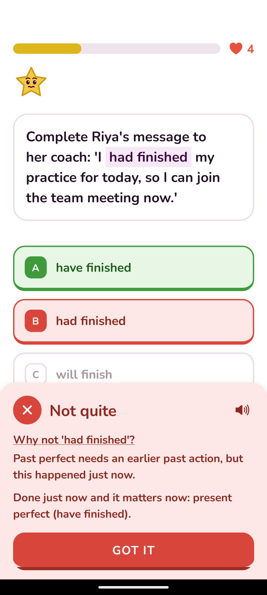
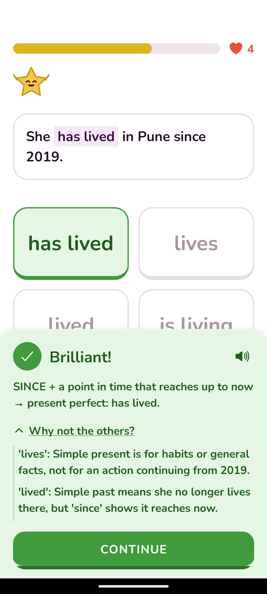

# G82 Report: "Why not this option?" for Every Wrong Option (App Part)

**Date:** 2026-11-09  
**Branch:** `gemini/g82-why-not-panel`  
**Owner Problem Addressed:**
> "A child often asks: 'Why is my answer wrong, and why didn't that other option work?' Today we only explain the correct answer. We need kid-friendly explanations for why specific options are wrong."

---

## 1. Summary of Changes

We implemented full end-to-end support for option-level rationales (`why`):
1. **Data Schema & Converters:**
   - Extended helper `q()` in `data/englishQuest/helpers.js` to accept `[text, mistakeTag, why]` for wrong options (with `why` optional, preserving backward compatibility).
   - Preserved `why` field across option mutations: `utils/mistakes.js` (`paperMistakeUpdates`), `services/firestoreContentApi.js` (`convertV1QuestionToV2`), and `useQuizEngine.js`.
2. **Pure Helper (`utils/whyNot.js`):**
   - Clean, functional helper calculating `wrongWhy`, `otherWhys`, `whyHeading`, and combined speech text.
   - Skips empty whys and never renders empty blocks or foldable sections if no `why` data exists.
3. **Training Feedback Sheet (`components/quiz/FeedbackSheet.js` & `screens/quiz/QuizScreenV2.js`):**
   - **Wrong Answer:** Prominently shows `Why not '<chosen>'?` with its explanation before the main explanation.
   - **Right Answer:** Main explanation first, followed by a folded `Why not the others?` section with a chevron toggle. Unfolding displays each wrong option with its specific rationale.
   - **Styling:** Retains identical typography (`17px`, `nunitoBold`) and palette colours (`fg`, `textSoft`).
   - **Read-Aloud:** Speaker icon in the header row reads aloud the why-not rationale together with the explanation via `expo-speech`.
4. **Exam Mode Review (`screens/paper/PracticePaperScreen.js`):**
   - Extended the paper answers review cards to show why-not rationales for completed practice papers.
5. **Content Verification:**
   - Annotated 3 Grammar Pro questions in `data/englishQuest/units/b1.js` (`eq-b1-perfect-quiz`) with verified, kid-friendly rationales.
6. **Automated Testing:**
   - Created `tests/whyNot.test.mjs` with 9 test cases covering right/wrong options, missing whys, object inputs, formatting, and speech strings.
   - Added to `npm test` script; all 55 test suites pass.

---

## 2. Visual Verification on Android Emulator

### A. Wrong Answer Flow (`g82-wrong.png`)
Choosing wrong option `"had finished"` triggers the "Not quite" feedback sheet:
- Header: Cross icon, "Not quite", and Speaker icon for text-to-speech.
- Section: Underlined `Why not 'had finished'?`.
- Rationale: *"Past perfect needs an earlier past action, but this happened just now."*
- Main explanation: *"Done just now and it matters now: present perfect (have finished)."*
- Action: "GOT IT" button.

---

### B. Right Answer Flow (`g82-right.png`)
Choosing correct option `"has lived"` triggers the "Brilliant!" feedback sheet:
- Header: Checkmark icon, "Brilliant!", and Speaker icon.
- Main explanation: *"SINCE + a point in time that reaches up to now → present perfect: has lived."*
- Folded toggle: `^ Why not the others?` (tapped to open).
- Rationales listed:
  - `'lives': Simple present is for habits or general facts, not for an action continuing from 2019.`
  - `'lived': Simple past means she no longer lives there, but 'since' shows it reaches now.`
- Action: "CONTINUE" button.

---

## 3. Test Results
- `tests/whyNot.test.mjs`:
  - `formatWhyNotHeading`: Formats heading correctly with chosen option.
  - `formatWhyNotOtherLine`: Formats option quote and why text.
  - `hasAnyWhys`: Correctly detects presence or absence of why properties.
  - `getWhyNotFeedback (wrong answer with why)`: Returns `wrongWhy` and heading.
  - `getWhyNotFeedback (wrong answer without why)`: Returns null `wrongWhy`.
  - `getWhyNotFeedback (legacy question without whys)`: Returns all nulls / empty array.
  - `getWhyNotFeedback (right answer with others)`: Populates `otherWhys`.
  - `getWhyNotFeedback (right answer without others)`: Returns empty `otherWhys`.
  - `buildOthersSpeechText`: Builds spoken text string for speech synthesizer.
- All 55 test suites in `npm test` pass.
- Metro and Android export bundle cleanly with 0 syntax or runtime errors.
